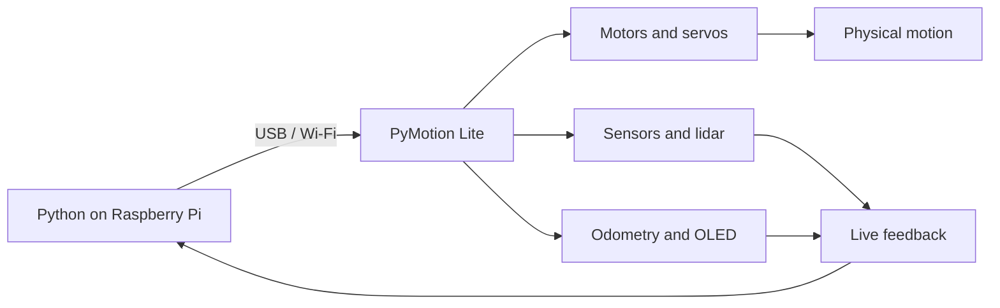

<div align="center">

<a href="README.md"></a>&nbsp;&nbsp;<a href="README_CN.md"></a>

<h1>PyMotion Lite</h1>

<p><strong>Take Raspberry Pi from computing to motion.</strong></p>
<p>Connect Linux and Python to real actuators through one consistent control surface for robotics learning, edge computing, and intelligent hardware prototypes.</p>

<p>
  <a href="https://pymotion.mintlify.site"></a>&nbsp;
  &nbsp;
  &nbsp;
  
</p>

</div>

PyMotion Lite brings DC motors, PWM servos, TTL bus servos, sensors, lidar, odometry, OLED output, and device status into one consistent `pm.lite` API. On Raspberry Pi, vision, algorithms, network services, and physical motion can share the same Python workflow.



## Why PyMotion Lite

| Feature | What it gives you |
| --- | --- |
| Python-native API | Work with real device capabilities without first implementing low-level protocols |
| Edge-ready | Combine algorithms, networking, and motion control on an ARM64 Linux host |
| Control plus feedback | Send motion targets and read encoders, measured speed, sensors, power, and device status |
| One API for USB and Wi-Fi | Move from wired development to mobile and wireless projects smoothly |
| Real-time workflows | Stream multiple data sources while continuously updating actuator targets |
| Offline installation | Install the SDK and dependencies from local ARM64 wheels into an isolated Python environment |

## Environment

- A 64-bit ARM host running Debian 13; the system architecture must be `aarch64`.
- The installer uses system CPython 3.13 to create an isolated environment; no Python packages are downloaded during SDK installation.
- Installing the udev rule requires a normal user with `sudo` access; do not run the main setup script directly as root.
- Use Visual Studio Code on a desktop system, or run the SDK environment directly on a headless system.
- USB connections require a data-capable USB cable.

## Quick start

Open the [PyMotion Lite Raspberry SDK repository](https://github.com/PyMotion-OS/PyMotion_Lite_Raspberry), then select **Code → Download ZIP** to download the SDK.

Extract the complete SDK package to a short path, for example `~/PyMotion_Lite_Raspberry`.

### 1. Prepare the SDK folder

Open a terminal and enter the SDK root:

```bash
cd ~/PyMotion_Lite_Raspberry
```

The folder must include at least:

```text
PyMotion_Lite_Raspberry/
├── setup-debian.sh
├── open-sdk-vscode.sh
├── run-sdk-python.sh
├── install-udev.sh
├── examples/
├── internal/
└── wheels/
```

Keep the complete folder structure. Do not copy an installer by itself, or move, remove, or modify `internal`, `wheels`, or `examples`.

### 2. Install the SDK

Run setup as your normal user:

```bash
bash ./setup-debian.sh
```

The script checks Debian and ARM64 compatibility, verifies bundle integrity, and installs the SDK and dependencies from local wheels into an isolated environment. The default SDK environment is:

```text
~/.local/share/pymotion-lite/venv-cp313-debian13
```

After setup, configure USB access for PyMotion Lite:

```bash
bash ./install-udev.sh
```

Disconnect and reconnect the board's USB cable to activate the new rule.

### 3. Open the SDK workspace

If VS Code is installed on the Raspberry Pi, run this from the SDK root:

```bash
bash ./open-sdk-vscode.sh
```

The launcher checks the installed SDK, copies examples to an editable workspace under your user profile, selects the correct Python interpreter, and opens a new VS Code window.

On a headless system or without VS Code, run examples with the SDK environment directly:

```bash
~/.local/share/pymotion-lite/venv-cp313-debian13/bin/python \
  ./examples/quick-start/01-pymotion-lite.py
```

### 4. Connect your PyMotion Lite board

Attach a data-capable USB cable and make sure the board is powered normally. Then set the board's current Token in the VS Code terminal or a regular terminal:

```bash
export PYMOTION_AUTH_TOKEN="your device Token"
```

In the VS Code terminal, run the read-only connection example:

```bash
python ./examples/quick-start/02-connection.py
```

This example only establishes a USB connection, reads the board status, and closes the connection. It does not drive motors or servos. A successful run prints output similar to:

```text
PyMotion Lite SDK: 1.0.1
Device ID: ...
Transport: usb
State: ...
Status age: ... s
```

Once you see the device ID, `Transport: usb`, and board status, the SDK is communicating with PyMotion Lite correctly. Continue with the other examples under `examples/quick-start` or follow the numbered lessons in `examples/lite-learning-course`.

Without VS Code, run the same example from the SDK root with the isolated environment:

```bash
export PYMOTION_AUTH_TOKEN="your device Token"
~/.local/share/pymotion-lite/venv-cp313-debian13/bin/python \
  ./examples/quick-start/02-connection.py
```

## Where to go next

| Goal | Start here |
| --- | --- |
| Learn the SDK and make the first connection | [Quick Start](examples/quick-start) |
| Learn motors, servos, sensors, and real-time control | [Lite Learning Course](examples/lite-learning-course) |
| Check the SDK environment | `~/.local/share/pymotion-lite/venv-cp313-debian13/bin/pymotion doctor --offline` |
| Look up features, APIs, and safety constraints | [Online User Manual](https://pymotion.mintlify.site) |

> [!CAUTION]
> Wire motors and servos only while power is disconnected. Use a suitable external actuator supply, lift wheels off the work surface, and clear the mechanism's full range of motion. Software stops and communication timeouts do not replace an immediately accessible physical power disconnect.

