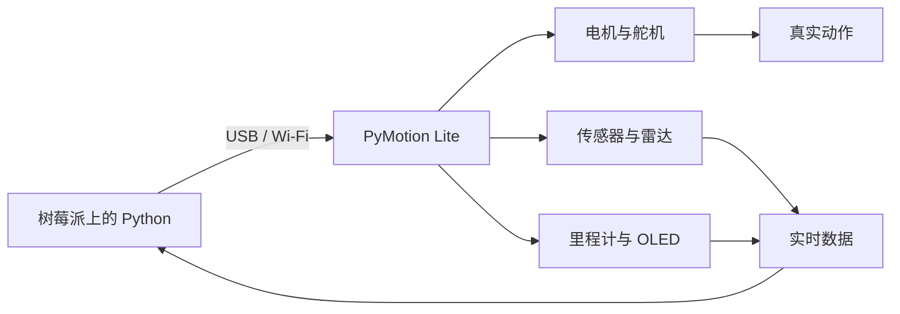

<div align="center">

<a href="README.md"></a>&nbsp;&nbsp;<a href="README_CN.md"></a>

<h1>PyMotion Lite</h1>

<p><strong>让树莓派从计算走向运动。</strong></p>
<p>把 Linux、Python 与真实执行器连接起来，为机器人学习、边缘计算和智能硬件原型提供清晰一致的控制入口。</p>

<p>
  <a href="https://pymotion.mintlify.site"></a>&nbsp;
  &nbsp;
  &nbsp;
  
</p>

</div>

PyMotion Lite 将直流电机、PWM 舵机、TTL 总线舵机、传感器、雷达、里程计、OLED 与设备状态统一到一套清晰的 `pm.lite` API 中。在树莓派上，可以把视觉、算法和网络服务与真实运动控制放进同一个 Python 工作流。



## 为什么是 PyMotion Lite

| 特点 | 你可以获得什么 |
| --- | --- |
| Python 原生 | 公开 API 直接对应设备能力，不必先处理底层通信协议 |
| 适合边缘计算 | 在 ARM64 Linux 主机上把算法、网络和运动控制组合到同一应用 |
| 控制与反馈一体 | 发出运动目标，同时读取编码器、实测转速、传感器、电源与设备状态 |
| USB / Wi-Fi 同一 API | 从有线调试平滑切换到移动机器人和无线应用 |
| 实时能力 | 连续接收多源数据，并持续更新电机、舵机等执行器目标 |
| 离线安装 | SDK 与依赖从包内 ARM64 wheel 安装到独立 Python 环境 |

## 运行环境

- 运行 Debian 13 的 64 位 ARM 主机，系统架构必须为 `aarch64`。
- 使用系统 CPython 3.13 创建独立虚拟环境；安装 SDK 时不从网络下载 Python 包。
- 安装 udev 规则需要当前普通用户具备 `sudo` 权限；不要直接以 root 用户运行主安装脚本。
- 桌面环境可使用 Visual Studio Code；无桌面或未安装 VS Code 时，可直接使用 SDK 虚拟环境。
- USB 连接需要支持数据传输的 USB 线。

## 快速开始

先打开 [PyMotion Lite Raspberry SDK 仓库](https://github.com/PyMotion-OS/PyMotion_Lite_Raspberry)，点击 **Code → Download ZIP** 下载 SDK。

下载完成后，将 SDK 包完整解压到路径较短的目录，例如 `~/PyMotion_Lite_Raspberry`。

### 1. 准备 SDK 目录

打开终端并进入 SDK 根目录：

```bash
cd ~/PyMotion_Lite_Raspberry
```

目录中应至少包含：

```text
PyMotion_Lite_Raspberry/
├── setup-debian.sh
├── open-sdk-vscode.sh
├── run-sdk-python.sh
├── install-udev.sh
├── examples/
├── internal/
└── wheels/
```

请完整保留 SDK 目录结构，不要单独复制安装脚本，也不要移动、删除或修改 `internal`、`wheels` 和 `examples`。

### 2. 安装 SDK

以当前普通用户运行：

```bash
bash ./setup-debian.sh
```

脚本会检查 Debian 版本和 ARM64 架构，校验 SDK 完整性，并从本地 wheel 将 SDK 与依赖安装到独立环境。默认 SDK 环境位于：

```text
~/.local/share/pymotion-lite/venv-cp313-debian13
```

安装结束后，配置 PyMotion Lite 的 USB 访问权限：

```bash
bash ./install-udev.sh
```

完成后请重新插拔板卡的 USB 线，使新规则生效。

### 3. 打开 SDK 工作区

如果树莓派安装了 VS Code，可在 SDK 根目录运行：

```bash
bash ./open-sdk-vscode.sh
```

启动器会检查已安装的 SDK 环境，把示例复制到当前用户的可编辑工作区，绑定正确的 Python 解释器，并使用新窗口打开 VS Code。

无桌面环境或未安装 VS Code 时，可直接使用 SDK 环境中的 Python：

```bash
~/.local/share/pymotion-lite/venv-cp313-debian13/bin/python \
  ./examples/quick-start/01-pymotion-lite.py
```

### 4. 连接你的 PyMotion Lite 板卡

连接板卡前，请先接好支持数据传输的 USB 线并确认板卡已经正常供电。然后在 VS Code 终端或普通终端中设置板卡当前 Token：

```bash
export PYMOTION_AUTH_TOKEN="设备的 Token"
```

在 VS Code 终端中，运行只读连接例程：

```bash
python ./examples/quick-start/02-connection.py
```

该例程只会建立 USB 连接、读取板卡状态并关闭连接，不会驱动电机或舵机。运行成功后，终端会显示类似信息：

```text
PyMotion Lite SDK: 1.0.1
Device ID: ...
Transport: usb
State: ...
Status age: ... s
```

看到设备 ID、`Transport: usb` 和板卡状态后，说明 SDK 已经能够正常访问 PyMotion Lite。接下来可以继续运行 `examples/quick-start` 中的其他例程，或按照 `examples/lite-learning-course` 的编号顺序学习完整功能。

如果不使用 VS Code，请在 SDK 根目录中通过独立环境运行同一个例程：

```bash
export PYMOTION_AUTH_TOKEN="设备的 Token"
~/.local/share/pymotion-lite/venv-cp313-debian13/bin/python \
  ./examples/quick-start/02-connection.py
```

## 从这里继续

| 我想做什么 | 从这里开始 |
| --- | --- |
| 认识 SDK 并完成首次连接 | [Quick Start](examples/quick-start) |
| 学习电机、舵机、传感器与实时控制 | [Lite Learning Course](examples/lite-learning-course) |
| 检查 SDK 环境 | `~/.local/share/pymotion-lite/venv-cp313-debian13/bin/pymotion doctor --offline` |
| 查询完整功能、API 与安全约束 | [在线使用手册](https://pymotion.mintlify.site) |

> [!CAUTION]
> 电机和舵机动作前，请在断电状态下完成接线，使用符合要求的外部供电，架空车轮并清空机构运动范围。软件停止与通信超时保护不能替代可立即操作的物理断电措施。

